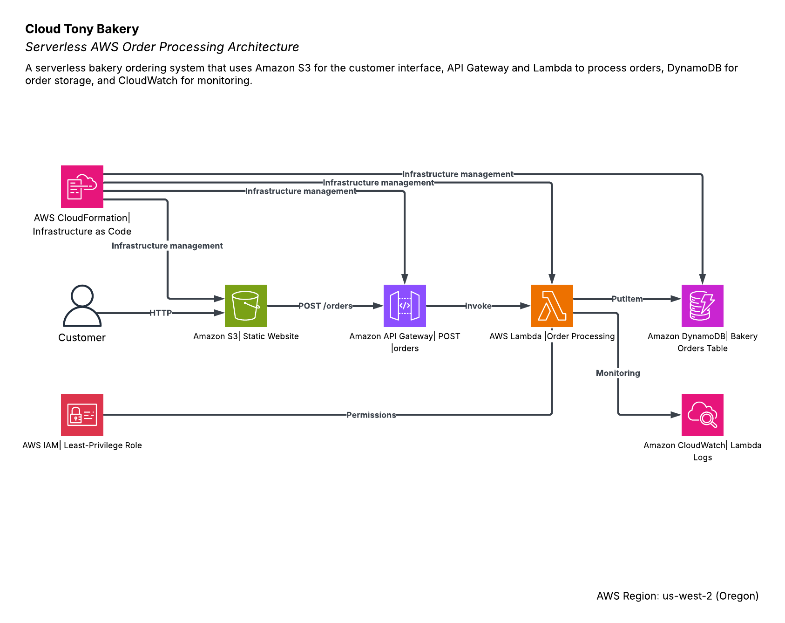

# Cloud Tony Bakery

Cloud Tony Bakery is a serverless AWS ordering application that allows a customer to select a bakery item and submit an order through a web interface. I built this project to demonstrate how multiple AWS managed services can work together in a simple serverless architecture.

## Architecture

The application follows this flow:

**Customer → Amazon S3 → API Gateway → AWS Lambda → Amazon DynamoDB**

AWS CloudWatch provides monitoring and logging for the Lambda function. An IAM execution role gives Lambda limited permission to write orders to DynamoDB.

## AWS Services

- **Amazon S3** hosts the static Cloud Tony Bakery website.
- **Amazon API Gateway** provides the public `POST /orders` API endpoint.
- **AWS Lambda** processes customer orders and generates a unique order ID.
- **Amazon DynamoDB** stores the customer name, bakery item, order ID, and timestamp.
- **Amazon CloudWatch** provides Lambda execution logging and monitoring.
- **AWS IAM** controls Lambda access using least-privilege permissions.
- **AWS CloudFormation** demonstrates Infrastructure as Code for the project.

## Infrastructure as Code

The `cloud-tony-bakery.yaml` CloudFormation template defines a DynamoDB table using on-demand billing. I deployed the template successfully in AWS CloudFormation to demonstrate that part of the infrastructure can be recreated automatically instead of being created manually through the AWS console.

## Project Files

- `index.html` - Cloud Tony Bakery web interface
- `lambda_function.py` - Serverless order-processing function
- `cloud-tony-bakery.yaml` - CloudFormation Infrastructure as Code
- `cloud-tony-bakery-architecture.png` - AWS architecture diagram

## How It Works

1. The customer opens the bakery website hosted in Amazon S3.
2. The customer enters a name and selects a bakery item.
3. The website sends the order to API Gateway.
4. API Gateway invokes the Lambda function.
5. Lambda generates a unique order ID and writes the order to DynamoDB.
6. The website displays a confirmation and the generated order ID.
7. CloudWatch records Lambda execution information for monitoring.

## Security

The Lambda function uses an IAM execution role instead of stored AWS credentials. The role follows least privilege and allows the function to write only to the required DynamoDB table.

For a production version, I would add HTTPS through CloudFront, stronger API authentication, and more restrictive public access controls.

## Reliability and Performance

The application uses managed serverless AWS services, so there are no EC2 servers to maintain. API Gateway, Lambda, and DynamoDB can automatically handle changes in request volume without manually provisioning servers.

## Cost

The architecture uses serverless and pay-per-use services, which keeps the cost very low for a small application. DynamoDB uses on-demand billing, Lambda charges based on execution, and S3 requires only a small amount of storage for the static website.

## What I Learned

This project helped me understand how individual AWS services connect into a complete application. One of the main challenges was configuring browser CORS between the S3 website and API Gateway. Testing each component separately helped isolate the problem and confirm that the API, Lambda function, and DynamoDB table were working before troubleshooting the browser connection.

## Author

Tony Reza  
Santa Monica College - CS 79C
